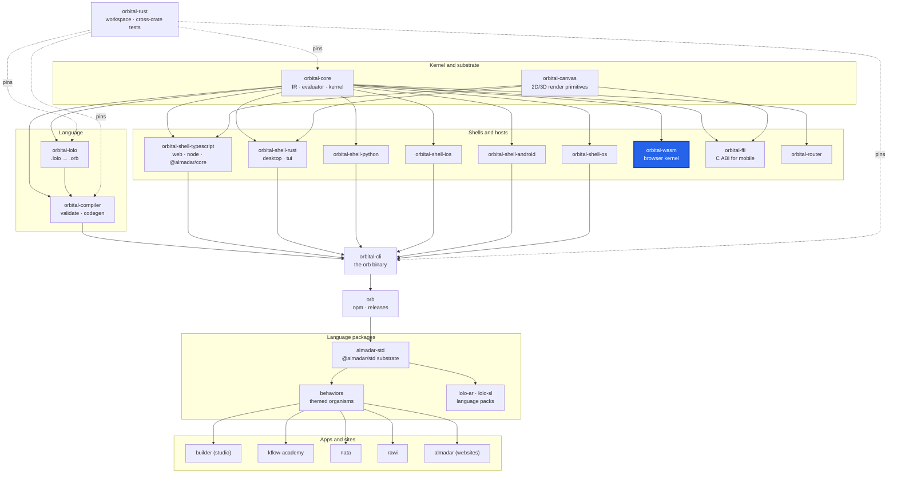

<div align="center">

# orbital-wasm

**The Almadar kernel as WebAssembly for JavaScript hosts, published to npm as `@almadar/kernel`.**

[](https://github.com/almadar-io/orbital-wasm/actions/workflows/ci.yml)
[](https://www.npmjs.com/package/@almadar/kernel)
[](LICENSE)

</div>

`wasm-bindgen` marshalling over `orbital_core::embed`. It exposes `Kernel` (the client role) and `Server` (the server role, whose I/O the host answers), both speaking the kernel's JSON wire. A failed operation throws a JS `Error`. The same kernel runs natively through [orbital-ffi](https://github.com/almadar-io/orbital-ffi) on iOS and Android.

## Where this fits



| Upstream (this repo depends on) | Downstream (depends on this repo) |
|---|---|
| [orbital-core](https://github.com/almadar-io/orbital-core): the embedded kernel it wraps | Browser and Node hosts that load `@almadar/kernel`. The workspace `make install-dev` runs `scripts/build.sh client` here before building the served web client |

## Quick start

Use the package from npm:

```bash
npm install @almadar/kernel
```

The package has two entry points: `@almadar/kernel` (the full kernel, for Node hosts and tools) and `@almadar/kernel/client` (the browser build, without the raw-socket store drivers). The `.wasm` files are exported as `./kernel.wasm` and `./client.wasm`. It requires Node 22 or newer.

## What's inside

| Path | Purpose |
|---|---|
| `src/` | The crate: `api.rs` (`KernelApi`, `ServerApi` over JSON strings), `lib.rs` (the `Kernel` and `Server` wasm-bindgen classes), `credentials.rs`, `stored.rs` |
| `js/` | The `@almadar/kernel` npm package; `scripts/build.sh` builds `pkg/` (full) and `pkg-client/` (client) |
| `js/test/` | Node tests for the built package |
| `tests/` | Crate tests that replay orbital-core's embed goldens |

Cargo features: `full` (default, enables `wire-drivers`) and `wire-drivers`. The client build is `--no-default-features`.

## Development

The crate tests read orbital-core's embed fixtures from a sibling checkout at `../orbital-core` (inside the monorepo that is `orbital-rust/crates/orbital-core`).

```bash
git clone https://github.com/almadar-io/orbital-core ../orbital-core
npm install --no-save --no-package-lock @almadar/core@^10 @almadar/std@^16 @almadar/lolo-ar@^1 @almadar/lolo-sl@^1
cargo test
rustup target add wasm32-unknown-unknown && cargo install wasm-bindgen-cli --version 0.2.126 --locked
cd js && sh scripts/build.sh && npm test
```

- CI (`.github/workflows/ci.yml`) runs the same steps on push and pull request to `main`, with binaryen version_133 for `wasm-opt`.
- Pushing a `js-v*` tag runs `publish-js.yml`, which builds and publishes `@almadar/kernel` under the `next` dist-tag; the orb release smoke promotes it to `latest`.
- Open gaps are tracked in [`Almadar_Gaps.md`](Almadar_Gaps.md). Work on `main` only; there are no feature branches.
- Inside the monorepo this repo is the submodule `orbital-rust/crates/orbital-wasm`.

## Docs

- [Orbital Core](https://github.com/itechdom/kflow.ai/blob/main/docs/Almadar_Orbital_Core.md)
- [Orbital Shell TypeScript](https://github.com/itechdom/kflow.ai/blob/main/docs/Almadar_Orbital_Shell_TypeScript.md)
- [Execution Semantics](https://github.com/itechdom/kflow.ai/blob/main/docs/Almadar_Execution_Semantics.md)

## License

[Business Source License 1.1](LICENSE): free for non-commercial use and internal evaluation; commercial production use needs a licence from Almadar FZE. Converts to Apache-2.0 on 2030-02-01.
